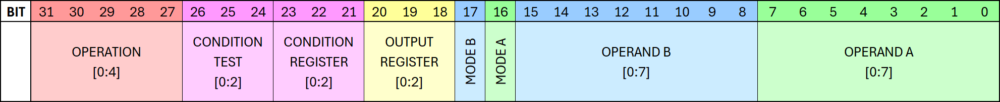
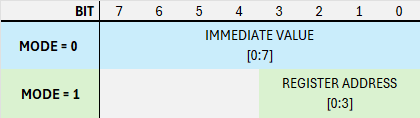

# Instruction Set

## Instruction

Every instruction is encoded in a 32-bit word with the following layout:

### Operation

This field specifies the operation to perform. Each operation receives two 8-bit input values, `A` and `B`, and produces an 8-bit result that is stored in the output reigster. Depending on the operation one or both inputs may be unused.

See the [Operations](#operations) section for a list of supported operations.

### Condition

Each instruction defines a condition for its execution using two fields:
- `CONDITION TEST` specifies the check to perform
- `CONDITION REGISTER` specifies which of the eight general-purpose registers supplies the value `C` to check.

The condition is evaluated immediately before the instruction executes, using the current value `C` of the selected register and producing either `true` or `false`. This happens before the instruction modifies any computer state, so any changes it makes to the condition register do not affect its own condition evaulation.

- If the condition evaluates to `true`, the instruction is executed.
- If the condition evaluates to `false`, the instruction is skipped. The program counter advances to the next instruction, but all other computer state remains unchanged.

There are 8 possible condition tests.
For any comparisons with 0, `C` is interpreted as a signed 8-bit two's complement integer ranging from -128 to 127.

Condition | Value | Evaluates to true when
:---:| :---: | ---
ALWAYS | `0b000` | Always no matter the input.
NEVER | `0b001` | Never no matter the input.
= 0 | `0b010` | `C = 0`
≠ 0 | `0b011` | `C ≠ 0`
< 0 | `0b100` | `C < 0`
≥ 0 | `0b101` | `C ≥ 0`
\> 0 | `0b110` | `C > 0`
≤ 0 | `0b111` | `C ≤ 0`

### Output Register

This part of the instruction specifies bits 0:2 of the address of the register in which the operations result is stored.
Bit 3 of the register address is determined by the operation: It is set to 1 for load_2 and cleared to 0 for all other operations.

### Operands A & B

Each instruction has two operands, A and B, which provide the inputs to the operation. Each operand consists of a 8-bit field, `OPERAND` and a mode bit, `MODE`, which determines how that field is interpreted:

- **Immediate mode (MODE = 0)**: The 8-bit field is used directly as the input value.

- **Register mode (MODE = 1)**: The lower 4 bits specify the address of the register whose current value should be used as the input. The upper 4 bits are unused and should be cleared to 0.

## Operations

### Load

Load operations write their input value directly to the output.

Operation | Value | Description
:---:| :---: | ---
LOAD2 | `0b00000` | Creates a 16-bit word using the value of `A` for the lower, and the value of `B` for the upper 8 bits. The value is then stored in the special function register, specified by the output address.
LOAD | `0b00001` | Output the value of `A`.

### Logic

The logic operations take the values of `A` and `B` and perform a bitwise logical operation on them, the result of which is then outputed.

Operation | Value | Description
:---:| :---: | ---
AND | `0b00010` | Bitwise and.
NAND | `0b00011` | Bitwise nand.
OR  | `0b00100` | Bitwise or.
NOR | `0b00101` | Bitwise nor.
XOR | `0b00110` | Bitwise xor.
XNOR | `0b00111` | Bitwise xnor.

### Arithmetic

The arithmetic operations take the values of `A` and `B` and perform an arithmetic operation on them, the result of which is then outputed. Every arithmetic operation also modifies the arithmetic carry bit, depending on the operation and its input values.

Operation | Value | Description
:---:| :---: | ---
ADD | `0b01000` | Calculates `A` + `B`.
SUBTRACT | `0b01001` | Calculates `A` - `B`.
ADD WITH CARRY | `0b01010` | Calculates `A` + `B` + `carry`.
SUBTRACT WITH CARRY | `0b01011` | Calculates `A` - `B` - (1 - `carry`).

### Shift

The shift operations take the value of `A` and shift it either to the left or to the right by one bit. The bit that is "shifted out" is always placed in the shift carry bit.

Operation | Value | Description
:---:| :---: | ---
SHIFT LEFT | `0b01100` | Shifts `A` one to the left. The LSB, bit 0, is set to `0`. This is equivalent to multiplying the unsigned value of `A` with 2.
SHIFT RIGHT | `0b01101` | Shifts `A` one to the right. The MSB, bit 7, is set to `0`. This is equivalent to dividing the unsigned value of `A` by 2.
ROTATE LEFT | `0b01110` | Shifts `A` one to the left. The LSB, bit 0, is set to the previous value of the shift carry bit.
ROTATE RIGHT | `0b01111` | Shifts `A` one to the right. The MSB, bit 7, is set to the previous value of the shift carry bit.

### Decode

The decode operations take the value of bits 0..2 of `A` as an unsigned 3-bit integer. A bit-mask is then generated, where only the bit specified by that value is set / cleared.

Operation | Value | Description
:---:| :---: | ---
NDECODE | `0b10000` | Generates a word where all 8 bits are set except for the bit specified by `A` which is cleared.
DECODE | `0b10001` | Generates a word where all 8 bits are cleared except for the bit specified by `A` which is set.

### Memory

The memory operations are used to read from / write to the memory of the computer. Both operations have in common, that they construct the 16 bit memory address by using `A` for the lower 8 bits of the address and the value of the `PAGE` register for the higher 8 bits.

Operation | Value | Description
:---:| :---: | ---
LOAD | `0b10100` | Loads the value of the memory cell at the current address and writes it to the output.
STORE | `0b10101` | Stores the value of `B` at the current address. The output of this operation is not written to any register.

### IO

AX08 has two io units. Each of them has the following three operations. Which io unit is used is indicated by bit 2 of the opcode, in the following table marked as an 'x'. A `0` stands for io-unit 0, a `1` for io-unit 1.

Operation | Value | Description
:---:| :---: | ---
POLL | `0b11x00` | Outputs a `1` if a value is available to be read, otherwise `0`.
READ | `0b11x01` | Reads a value from the io port.
WRITE | `0b11x10` | Writes the value of `A` to the io port.

### Break

The break instruction causes the ax08 computer to halt at the end of the instruction. Combined with conditions this allows for a simple version of "Software Breakpoints".

Operation | Value | Description
:---:| :---: | ---
BREAK | `0b11111` | Causes the computer to halt.
