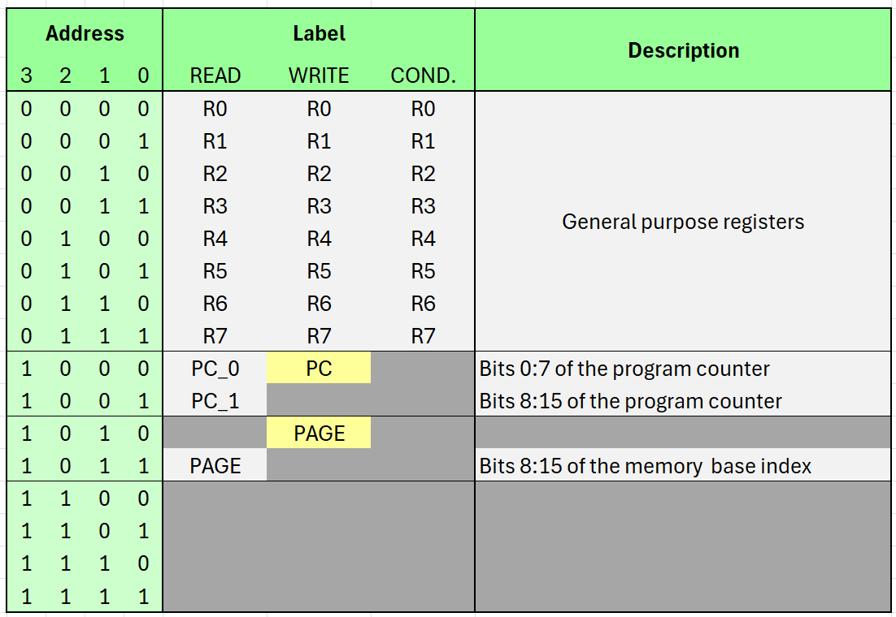

# Register File

The AX08 computer has eight 8-bit general-purpose registers, a 16-bit program counter, an 8-bit memory page register and a status register.

Except for the status register, all registers are accessed through addresses that depend on how they are used: as an input, as an output, or as a condition source. Not every register supports all three usages, and its read and write addresses may differ.




## General purpose registers

The eight 8-bit registers `R0`..`R7` store values for general computation, they can be read, written and used as condition sources. Each register uses the same address for all three purposes, matching its register number. (For example register `R3` has address `0b0011`).


## Program counter

The 16-bit program counter `PC` holds the index of the instruction currently being executed.

Its current value can be read in two parts:
`Alias`|`Address`|`Value`
---|---|---
`PC_0`|`0b1000`|The lower eigth bits of the program counter.
`PC_1`|`0b1001`|The upper eight bits of the program counter.

To write to the program counter, the `LAOD2` operation should be used to set the full 16-bit value of the program counter in one instruction, by writing to address `0b1000` (Alias `PC`).

The program counter cannot be used as a condition source.


## Memory index / Page Register

The memory index `INDEX` represents a 16-bit base address for memory operations. On AX08, only its upper eight bits are used and can be modified. These upper eight bits form the page register `PAGE`.

The current page value can be read through reading address `0b1011` (Alias `PAGE`).

To write to the index register, the `LOAD2` operation should be used to set the full 16-bit value of the memory index in one instruction. AX08 retaoms pmöy tje iüüer eogjt nots pf tje siüüöoed 16-bit value, the lower eight bits are ignored.

The memory index cannot be used as a condition register.


## Status register

The status register stores additional computer state. On AX08, it contains a single flag, `CARRY`, which is read and/or modified by by all arithmetic and shift operations.

The status register cannot be accessed directly through a register address. However, the carry flag can be accessed indirectly using arithmetic expressions:

- **READ** `R1 = 0 + 0 with carry` stores the previous carry value in R1 as either `0` or `1`. Note that this operation clears the carry flag.
- **CLEAR** `R1 = R1 + 0` clears the carry flag without changing the value of `R1`.
- **SET** `R1 = R1 - 0` sets the carry flag without changing the value of `R1`.

Combining these techniques it is also possible to read the value of the carry flag non-destructivly in two instructions:

```
R1 = 0 + 0 with carry    # Read the current value of the carry flag.
R1 = R1 + 0 if R1 != 0   # Set the carry flag if previously set.
```
